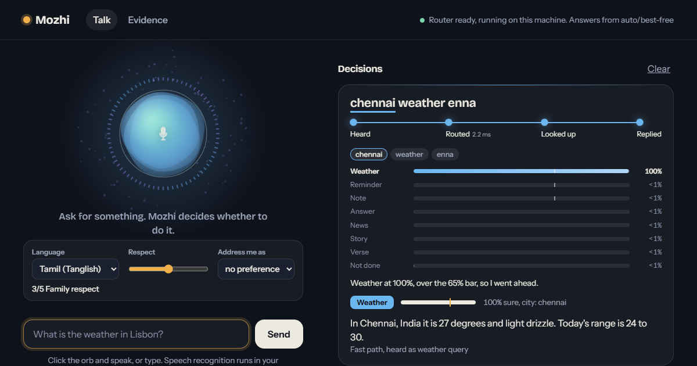
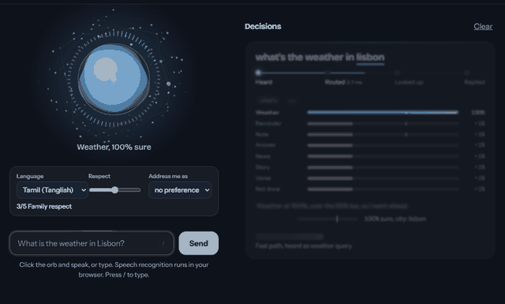
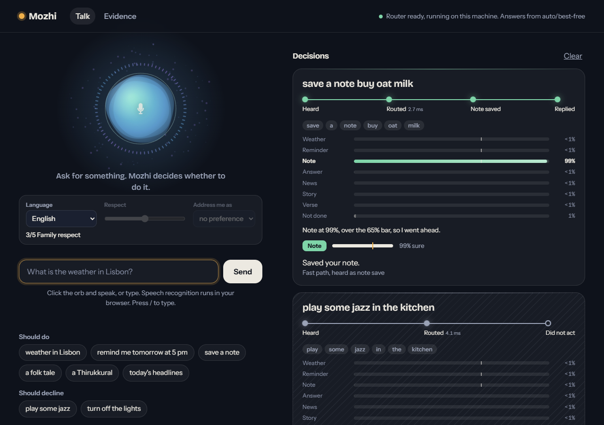
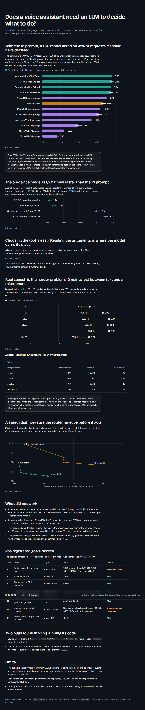
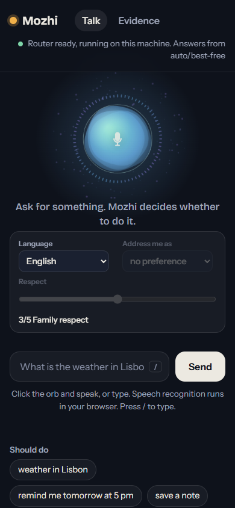
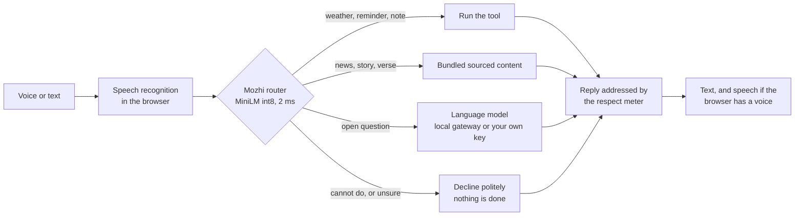

<h1 align="center">Mozhi</h1>

<p align="center"><b>A Tamil, Malayalam and English voice assistant that checks before it acts.</b><br>
A 2 ms trained router instead of an LLM prompt. It declines what it cannot do and speaks to you at the respect level you choose.</p>

<p align="center">
  <a href="https://brej-29.github.io/mozhi/"></a>
  <a href="https://github.com/brej-29/mozhi/actions/workflows/ci.yml"></a>
  
  
  
</p>

<p align="center"><a href="https://brej-29.github.io/mozhi/"></a></p>

**Mozhi** (மொழி, മൊഴി) means "speech" or "language" in Tamil and Malayalam. It started as a Jarvis voice agent that asked a small language model to choose tools. I measured that approach, found it slow and unreliable, and rebuilt it around a 23 MB fine-tuned router that decides in about 2 milliseconds.

**Try it:** [brej-29.github.io/mozhi](https://brej-29.github.io/mozhi/) (no install, the router runs in your browser).

## At a glance

| | |
|---|---|
| Router accuracy | **0.941** action macro-F1 (95% CI 0.916 to 0.962), 2,805 test requests |
| False actions | **0.8%** (acting on something it should have declined) |
| Speed | **2.2 ms** median, against 1,047 ms for the best LLM prompt and 3,333 ms for the original one |
| Size | 22.9 MB int8 ONNX; Windows app 62.8 MB |
| Languages | English (finished), Tamil and Malayalam (first model, below target, see [limits](#limits)) |
| Respect meter | 5 levels: address term plus polite or informal "you" |
| Content | 1,475 public-domain verses, 14 folk tale summaries with sources |
| Tests | 47 automated tests, CI on every push |

## What it looks like

| Reading a request | The orb, in four states |
|---|---|
|  |  |
| Every request becomes a slip: the words heard, a probability bar for every tool, the decline threshold, and a one-line reason. | Listening uses the live microphone spectrum, thinking sends signals around a constellation, speaking pulses with each word. |

<details><summary>More screenshots</summary>

| Talk | Evidence page | Phone |
|---|---|---|
|  |  |  |

</details>

## The question

Does a voice assistant need a language model to decide what to do? My first version said yes and I had never measured it. A request like "play some jazz" should never become a weather lookup or a saved note.



## Results

All numbers come from [`bench/results`](bench/results) with 95% bootstrap intervals. Metric: action macro-F1 over weather, reminder, note and "no action", on the MASSIVE English test split (Amazon, CC BY 4.0). The thresholds were written down in [`docs/PREREG.md`](docs/PREREG.md) before training.

| System | Requests | Action macro-F1 (95% CI) | False actions | Declines what it should |
|---|---|---|---|---|
| Keyword rules | 2,805 | 0.707 (0.677 to 0.736) | 9.9% | 64.8% |
| TF-IDF + linear | 2,805 | 0.930 (0.906 to 0.953) | 0.7% | 98.3% |
| **Joint router (shipped)** | 2,805 | **0.941 (0.916 to 0.962)** | **0.8%** | **98.5%** |
| Original V1 prompt, Qwen 1.5B | 539 | 0.490 (0.447 to 0.537) | 40.7% | 0% |
| Constrained prompt, Qwen 1.5B | 539 | 0.879 (0.842 to 0.912) | 3.7% | 89.0% |
| Constrained prompt, Mistral 7B | 539 | 0.791 (0.742 to 0.835) | 10.0% | 64.5% |
| Joint router, same 539 | 539 | 0.953 (0.928 to 0.975) | 1.7% | 98.5% |

The LLM rows use a 539-request stratified subset because each run is slow. The original prompt gave a valid answer for 55% of requests with Qwen 1.5B.

| Speed (idle machine, 150 requests) | Median | 95th percentile |
|---|---|---|
| Joint router | 2.2 ms | 3.4 ms |
| Constrained LLM prompt | 1,047 ms | 1,588 ms |
| Original V1 prompt | 3,333 ms | 5,680 ms |

| Real speech (SLURP through Whisper) | Word error rate | Routing macro-F1 |
|---|---|---|
| base.en | 25.7% | 0.841 |
| small.en | 20.3% | 0.882 |
| medium.en | 17.4% | 0.929 |

Training on 6,600 real recogniser transcripts is what closed most of the speech gap.

### Pre-registered thresholds: what was met and what was not

| Check | Outcome |
|---|---|
| City and time slots | Met (97.5% and 85.5%) |
| False actions | Met (0.6%) |
| p95 latency | Met (3.4 ms) |
| Beat the original prompt | Met (+46 points, CI 41 to 51) |
| Beat a fair constrained prompt by 10 points | **Missed** (+7.4, CI 3.8 to 11.2) |
| Clean-text accuracy | MASSIVE-only model met it; the shipped speech-aware model missed by a hair (0.948 mean) |
| Speech gap | **Missed** with base.en, met with medium.en |

## What did not work

| Tried | Result | Change |
|---|---|---|
| Paste docs into the V1 prompt | Removing them raised macro-F1 from 0.49 to 0.67 and valid answers from 55% to 91% | Dropped the docs |
| Train on MASSIVE alone | It has no "save a note" intent | Added hand-written notes to train and dev only; test untouched |
| Clean-text training for voice | Lost 10 points on Whisper base.en | Trained on real transcripts |
| Router first, LLM when unsure | 0.940, no gain, 1.4 s tail | Dropped |
| Free hosted Docker Space | Free CPU tier now needs a paid plan | GitHub Pages, router in the browser |
| Keep the visitor's key in localStorage | Other pages on the same domain could read it | Tab-only storage, old key deleted on load |
| English router on Tamil script | Split words into letters, called everything "play music" | Separate multilingual router |

I also reproduced two bugs in the original code with [`bench/repro_v1_bugs.py`](bench/repro_v1_bugs.py): a missing import that crashed note saving, and a repair prompt that never included the model's output.

## Tamil, Malayalam and the respect meter

Most people in Tamil Nadu and Kerala talk to a phone in their own language, and the way you address someone carries respect. A flat "you" is wrong in both. One dial changes the address term and the polite or informal "you" together.

| Level | Feel | Tamil | Malayalam |
|---|---|---|---|
| 1 | Close friend | da, di | da, di |
| 2 | Warm | thambi, thangachi | mone, mole |
| 3 | Family respect | anna, akka | chetta, chechi |
| 4 | Polite | sir, madam | saar, madam |
| 5 | Deferential | ayya, amma, muthalali | thampurane, thampuratti, muthalali |

- Sample requests switch to **Tanglish** or **Manglish** (romanised Tamil or Malayalam). The page itself stays English.
- Replies are English by default, addressed by the meter ("Anna, in Chennai it is 27 degrees"). A setting turns on Tamil and Malayalam script replies.
- Content: **1,475 public-domain verses** (Thirukkural, Aathichoodi, Jnanappana, Harinamakeerthanam, Veena Poovu) and **14 folk tales** told from my own summaries with source links. The source books are in copyright, so no text is copied. See [`docs/MOZHI.md`](docs/MOZHI.md).

### Limits

- The first Tamil and Malayalam router scores **0.818 and 0.809** macro-F1 against a 0.85 target set in advance. Malayalam also missed its hand-written probe target (0.73 against 0.80). A larger pretrained encoder is the next step. Full table: [`bench/results/J2_REPORT.md`](bench/results/J2_REPORT.md).
- Tanglish and Manglish were not trained or measured. They work best mixed with English words.
- Tamil and Malayalam wording is a draft awaiting native-speaker review.
- The browser copy has the English router only; Tamil and Malayalam script run in the desktop app and local server.
- Speech output needs a Tamil or Malayalam voice in your browser, and the machine I tested on had English voices only.
- Microphone input is not covered by automated tests.

## Run it

```bash
make setup      # Python 3.11 environment with uv
make test       # 47 tests
make run        # http://127.0.0.1:8765
make exe        # one-file Windows app in dist/mozhi.exe
```

Open questions use a language model through OmniRoute (the `omniroute` npm package) or any OpenAI-compatible endpoint. Copy `.env.example` to `.env` and set `LLM_ENDPOINT`, `LLM_API_KEY` and optionally `LLM_MODEL`. The local app starts OmniRoute if it is not running and stops it on exit only if it started it. The hosted page asks visitors for their own key (kept for that tab only). A monthly budget and a daily call cap protect your account.

## Repository map

| Path | What is in it |
|---|---|
| `mozhi/` | Server, tools, routers, benchmark code, web UI |
| `mozhi/web/` | The whole front end (vanilla JS, canvas orb, onnxruntime-web) |
| `training/` | Router training and synthetic data |
| `bench/` | Evaluation scripts and every result file |
| `content/` | Build script for the verse collection and the folk tale summaries |
| `docs/` | [Pre-registration](docs/PREREG.md), [architecture](docs/ARCHITECTURE.md), [Tamil and Malayalam design note](docs/MOZHI.md), [handoff](docs/HANDOFF.md) |
| `packaging/` | Windows app and GitHub Pages build |

## Reproduce

```bash
make eval        # every baseline and the summary
make train       # the English router
make repro       # the two original-code bugs
```

## Licences and credits

MIT for the code. Data: MASSIVE (Amazon, CC BY 4.0) and SLURP recordings for evaluation. Verses: the Thirukkural JSON dataset (Apache-2.0) and Tamil and Malayalam Wikisource (CC BY-SA), each verse linked to its source. Folk tales: own summaries, linked to Seethalakshmi (1960), Jacob (1960), the Stories From India podcast and Kalampedia.

Built by [Brejesh Balakrishnan](https://github.com/brej-29). Earlier names of this project: Jarvis voice agent, Koottu.
