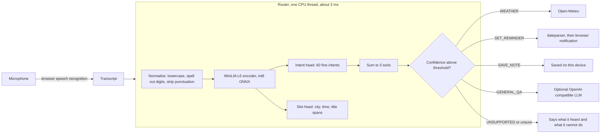

# Architecture

## Why it is built this way

| Decision | Reason (evidence in `bench/results`) |
|---|---|
| One small encoder with two heads, not an LLM | The V1 prompt scored 0.49 macro-F1 with Qwen2.5 1.5B and took seconds. The encoder scores about 0.95 in 3 ms. |
| 60 fine intents summed into 5 tools | Fine labels give the model more to learn from and let the UI say "that sounds like a request to play music". |
| Abstention is a threshold on summed tool probability | One number, tuned on dev, and exposed as a dial (see the Evidence page). Declining is cheap, a wrong reminder is not. |
| Router never writes free text | Nothing the router returns can fail JSON parsing, and its output cannot carry instructions to a tool. |
| Actions run in the browser | Reminders and notes are stored on the device. The server is stateless, so the free host can sleep and lose nothing. |
| LLM is optional and only answers general questions | The cascade experiment showed an LLM fallback made routing worse. |

## Files

| Path | Role |
|---|---|
| `mozhi/routers/joint.py` | Runtime router (onnxruntime, tokenizers, numpy only) |
| `mozhi/routers/{rules,linear,llm,cascade}.py` | Baselines and the cascade used in the benchmark |
| `mozhi/tools.py` | Weather, reminder, note, unsupported reply, optional LLM answer |
| `mozhi/server.py`, `mozhi/web/` | FastAPI app and the static UI |
| `mozhi/bench/` | Data mapping, metrics, runner, ASR and latency scripts |
| `training/` | Joint model training and synthetic note data |
| `bench/results/` | Every result file and per-request predictions |
| `docs/PREREG.md` | Metrics and thresholds, written before any model was trained |

## Security notes

- The server rejects requests whose `Host` header is not loopback (or listed in `MOZHI_ALLOWED_HOSTS`), which blocks DNS rebinding against the local app.
- LLM keys come from environment variables only (`MOZHI_LLM_API_KEY`) and are never logged or sent to the browser.
- Router output is a closed set of five labels plus extracted text spans, so there is no model-generated JSON to trust.
