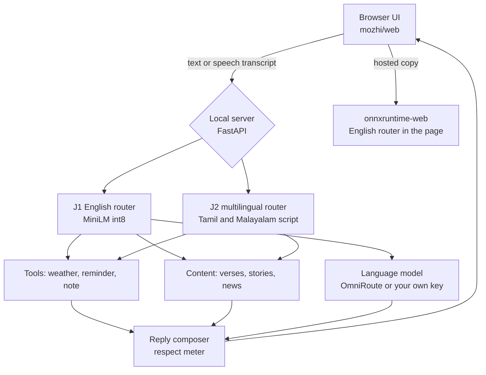

# Mozhi handoff

Everything someone needs to pick this project up, or to write about it, in one place. Numbers come from `bench/results`; anything not measured is marked unverified. Last updated 2026-11-08.

## 1. Identity

| Item | Value |
|---|---|
| Name | **Mozhi** (மொழி, മൊഴി: "speech" or "language"). Earlier names: Jarvis voice agent (V1 and V2), Koottu (dropped: sounded like a dating app). Native-speaker check of the meaning is still open. |
| One line | A Tamil, Malayalam and English voice assistant whose 2 ms trained router replaces LLM prompting, declines what it cannot do, and speaks at the respect level you choose. |
| Author | Brejesh Balakrishnan (GitHub: brej-29). Solo project. |
| Repository | https://github.com/brej-29/mozhi (renamed from `jarvis-voice-agent`; GitHub redirects old links) |
| Live demo | https://brej-29.github.io/mozhi/ (GitHub Pages, deployed from `main`) |
| Licence | MIT |
| Local folder | `D:\Project\jarvis-voice-agent` (folder name not renamed; rename it when no tool has it open) |

## 2. The story in five lines

1. V1 was a Jarvis voice agent that asked a small LLM to pick a tool from a prompt. Nobody had measured it.
2. I measured it: valid answer on 55% of requests, 3.3 s median, and it acted on 40.7% of requests it should have declined.
3. I rebuilt it around a fine-tuned MiniLM router (23 MB, int8 ONNX): 0.941 macro-F1, 0.8% false actions, 2.2 ms. Evaluation was pre-registered and misses are reported.
4. It now runs as a Windows app and as a browser-only site, with real speech tested through Whisper.
5. Then I added Tamil and Malayalam, a five-level respect meter, verses, folk tales, news, a Tanglish and Manglish sample mode, and a redesigned decision view and orb. The Tamil and Malayalam router is a first model that misses its target.

## 3. Goals and success criteria

| Goal | Status |
|---|---|
| A real, specific problem proven by measurement | Done: prompt-based routing is slow, unreliable and acts when it should not |
| Baselines, ablations, honest evaluation, pre-registered thresholds | Done (`docs/PREREG.md`); several thresholds missed and reported |
| Clean engineering: tests, CI, packaging | Done: 47 tests, ruff, GitHub Actions, PyInstaller app, Pages build |
| Distinctive UI with evidence visible | Done: decision slips, score bars, evidence page, canvas orb |
| Free live deployment from `main` | Done: GitHub Pages |
| Tamil and Malayalam that works | Partly: first router at 0.82 and 0.81 against 0.85 |
| Native-quality Tamil and Malayalam wording | Not done: needs a native speaker |

## 4. Architecture

| Part | File or folder | Notes |
|---|---|---|
| Server | `mozhi/server.py` | Routes native script to J2, everything else to J1; SSE streaming |
| English router | `mozhi/routers/joint.py`, `models/joint` | 22.9 MB int8 ONNX, trained by `training/train_joint.py` |
| Multilingual router | `mozhi/routers/joint2.py`, `models/joint2` | 0.9 MB, first model, `training/train_joint2.py` |
| Tools | `mozhi/tools.py`, `mozhi/news.py` | Open-Meteo weather, reminders (dateparser), notes, Google News RSS |
| LLM client and spend guard | `mozhi/llm.py` | Monthly budget, daily call cap, fail-closed ledger, persona prompt for the respect meter |
| OmniRoute lifecycle | `mozhi/omniroute.py` | Starts it if not running, stops it on exit only if this app started it |
| UI | `mozhi/web/` | `app.js` (state), `mozhi.js` (language and respect layer), `engine.js` (browser backend, BYOK), `orb.js`, `evidence.js`, `i18n.json`, `content/` |
| Benchmarks | `mozhi/bench/`, `bench/` | All result files and the summary |
| Packaging | `packaging/mozhi.spec`, `packaging/build_pages.py` | One-file exe, Pages site |

## 5. Problems faced and what changed

| Problem | What happened | Resolution |
|---|---|---|
| V1 never measured | Prompt router: 0.490 macro-F1, 55% valid | Rebuilt around a trained router |
| MASSIVE has no note intent | Model could not save notes | Synthetic note data in train and dev only |
| Speech gap | 10 points lost on Whisper base.en | Trained on 6,600 real transcripts |
| Hosting | Free Docker Space needs a paid plan | GitHub Pages, router in browser; third-party code vendored with pinned hashes under a CSP |
| Secrets | Visitor key briefly kept in localStorage | Tab-only storage, old key deleted on load, rotate any key entered in that window |
| Spend risk | LLM calls could run up cost | Budget and call cap, reserve before call, fail closed |
| Windows quirks | cp1252 console errors, HF symlink privileges, CUDA DLL loading | UTF-8 env var, local-dir snapshots, explicit DLL dirs |
| English router on Tamil script | Letters split apart, everything routed to "play music" | Language-aware routing to J2 |
| Small Tamil and Malayalam model | 0.818 and 0.809 vs 0.85 | Reported; larger pretrained encoder is next |
| Browser voices | Test machine had English voices only | App shows text and never reads Tamil with an English voice |
| Tool friction | Long multi-heredoc shell commands with Tamil text failed to parse | Write files with the editor tool, run small scripts |

## 6. Results to quote

| Claim | Number | Where |
|---|---|---|
| Router accuracy | 0.941 action macro-F1 (0.916 to 0.962), n = 2,805 | `bench/results/SUMMARY.md` |
| False actions | 0.8% | same |
| Median speed | 2.2 ms (p95 3.4 ms) | `bench/results/latency.json` |
| Best constrained LLM prompt | 0.879 (Qwen 1.5B), 1,047 ms | same |
| Original V1 prompt | 0.490, 55% valid, 40.7% false actions, 3,333 ms | same |
| Router vs V1 prompt | +46 points (CI 41 to 51) | `docs/PREREG.md` outcomes |
| Whisper medium.en routing | 0.929 | SUMMARY |
| Tamil and Malayalam first router | 0.818 and 0.809 | `bench/results/J2_REPORT.md` |

## 7. Content and rights

| Source | Use | Status |
|---|---|---|
| Thirukkural (tk120404/thirukkural) | 1,330 verses with meanings | Apache-2.0 dataset, public domain work |
| Aathichoodi, Jnanappana, Harinamakeerthanam, Veena Poovu (Wikisource) | 109 + 36 verses | CC BY-SA transcription, source link on each verse |
| Folk tales (Seethalakshmi 1960, Jacob 1960, Storytelling Institute, Stories From India, Kalampedia) | 14 summaries in my own words with links | Sources in copyright, no text copied |
| MASSIVE | Training and evaluation | CC BY 4.0 |
| SLURP | Speech evaluation and augmentation | Not stored in the repo |

## 8. Copy-ready text

### Resume bullets (pick three or four)

- Replaced an LLM-prompt tool router in a voice assistant with a fine-tuned MiniLM (int8 ONNX, 23 MB): 0.941 action macro-F1 (95% CI 0.916 to 0.962) on 2,805 test requests, 0.8% false actions, 2.2 ms median latency versus 1,047 ms for a constrained LLM prompt.
- Measured the original design before rebuilding it: the V1 prompt reached 0.490 macro-F1 and a valid answer on 55% of requests; the trained router beat it by 46 points (CI 41 to 51).
- Pre-registered thresholds, ran 3 seeds with bootstrap intervals and 12 compared systems, and reported the misses.
- Closed a 10-point speech gap by training on 6,600 real Whisper transcripts (0.929 routing macro-F1 on medium.en).
- Shipped as a 62.8 MB Windows app, a browser-only GitHub Pages build (ONNX in WebAssembly) and a FastAPI server, with 47 tests and CI.
- Added Tamil and Malayalam with a five-level respect meter, 1,475 public-domain verses and 14 source-linked folk tales, keeping copyrighted text out of the repository.

### LinkedIn project entry

**Mozhi: a voice assistant that checks before it acts** (Tamil, Malayalam, English). I took a voice assistant that let a small LLM pick its tools, measured how it failed, and replaced the LLM with a 23 MB trained router. On 2,805 test requests it scores 0.941 action macro-F1 with 0.8% false actions and answers in 2.2 ms. It runs as a Windows app and as a browser-only site, speaks Tamil and Malayalam, and adjusts how it addresses you on a five-step respect meter. Skills: Python, PyTorch, ONNX Runtime, FastAPI, JavaScript, NLP evaluation, speech recognition.

### LinkedIn post, version 1 (the measurement story)

I wanted to know one thing: does a voice assistant need an LLM to decide what to do?

My first version asked a small model to pick a tool from a prompt. When I finally measured it, the answer was valid on only 55% of requests, the median time was over 3 seconds, and it acted on about 4 in 10 requests it should have refused.

So I trained a 23 MB router instead. 0.941 macro-F1, 0.8% false actions, 2.2 ms. The best LLM prompt I could build reached 0.879 on the same requests.

What I liked most was writing the pass marks down first. I missed a few of them, and the write-up says so.

Code, live demo and every number are in the repo. Link in the comments.

### LinkedIn post, version 2 (the language story)

Most people near me talk to their phone in Tamil or Malayalam, and "you" is not one word in either. Calling someone "da" and calling them "sir" are different sentences.

So Mozhi has a dial. Five levels change the address term and whether it uses the polite or informal "you". I also added verses (Thirukkural, Aathichoodi, Jnanappana) and folk tales, with the source shown on each.

It is not finished: my first Tamil and Malayalam router scores 0.82 and 0.81 against a 0.85 target I set before training, so I am retraining it. The wording also needs a native speaker to check it.

Open source, runs in the browser. Link in the comments.

Notes: "Most people near me" is a claim about your own community; keep it only if true. "About 4 in 10" is the 40.7% false action rate of the V1 prompt on Qwen 1.5B.

### Portfolio page

Headline: Mozhi, a voice assistant that checks before it acts. Subhead: A 2 ms trained router instead of an LLM prompt, in Tamil, Malayalam and English, with a dial for how respectfully it talks to you. Sections: the question, what I found, what I built, how I checked, why Tamil and Malayalam, what is next (copy in the README). Images: `docs/images/og.png`, `decision.gif`, `orb.gif`, `evidence.png`, `mobile.png`.

## 9. Claims to avoid

| Do not say | Say instead |
|---|---|
| "Supports Tamil and Malayalam" alone | "First Tamil and Malayalam router at 0.82 and 0.81 macro-F1, below a 0.85 target" |
| "1,500 times faster than LLMs" | "2.2 ms against 1,047 ms (constrained) and 3,333 ms (original prompt)" |
| "Beats GPT-class models" | "Beats small local models (Qwen 0.5B and 1.5B, Mistral 7B) run through llama.cpp" |
| "Works on real speech" | "0.929 on Whisper medium.en transcripts, 0.841 on base.en" |
| "Native-quality Tamil and Malayalam" | "Draft wording, not yet reviewed by a native speaker" |
| "Understands Tanglish and Manglish" | "Sample requests in romanised text work best mixed with English words; not trained or measured" |
| "Speaks Tamil and Malayalam" | "Shows the text; speech output needs a Tamil or Malayalam browser voice" |

## 10. SEO and discoverability (done)

| Item | Where |
|---|---|
| Title, description, canonical, robots, keywords | `mozhi/web/index.html` head |
| Open Graph and Twitter card with a 1200x630 image | head, `mozhi/web/og.png` |
| JSON-LD `SoftwareApplication` with author, licence, languages, price | head |
| Visible explanatory text (what, how it compares, languages, limits) | `#about` section |
| `robots.txt`, `sitemap.xml` | `mozhi/web/` |
| `llms.txt` summary for AI assistants and crawlers | `mozhi/web/llms.txt` |
| 20 GitHub topics, description and homepage | repository settings |
| README with the same facts and keywords | `README.md` |

Not in my control and still to do by hand: submit the sitemap in Google Search Console (verify the `brej-29.github.io` property first), post the link on LinkedIn and in a Hacker News or Reddit r/MachineLearning thread, and ask for a link from your portfolio site. Search engines index slowly and nothing guarantees a ranking.

## 11. Open items

| Item | Notes |
|---|---|
| Retrain the Tamil and Malayalam router on a pretrained multilingual encoder | Planned in `docs/MOZHI.md`; thresholds T8, T13, T14 not yet met or measured |
| Browser decision parity for J2 (T12) | Only token ids compared |
| Native-speaker review of Tamil and Malayalam strings | `mozhi/web/i18n.json`, `mozhi/web/content/stories.json` |
| Tamil and Malayalam voices | Browser voices vary; options are Piper `ml_IN` (Malayalam) and MMS-TTS (non-commercial) |
| Tanglish and Manglish training data | Not trained or measured |
| Rebuild the Windows exe | `make exe`; includes `models/joint2` |
| Public exe release | Held back; publish a GitHub release by hand if wanted |
| Rotate any API key entered on the hosted page before the storage fix | One-time precaution |
| Earlier commits from before the rebuild carry a co-author trailer from an unrelated tool | Left as is |
| Rename the local folder | `D:\Project\jarvis-voice-agent` to `D:\Project\mozhi` |

## 12. Working notes

- Environment: Windows 11, Python 3.11 through `uv`, RTX 3050 6 GB for LLM baselines, Edge for screenshots (`bench/shots.py`, `bench/media.py`).
- Workflow: feature branches and pull requests, CI green before merge, no force pushes, nothing secret committed (`.env` is ignored; `.env.example` is committed).
- Heavy coding was delegated to Codex where possible; its first multilingual model is `models/joint2`.
- Environment variables renamed from `JARVIS_*` to `MOZHI_*`; the spend ledger moves from `.jarvis_spend.json` to `.mozhi_spend.json` automatically.
- Wake phrase: "jarvis" still works in reminders (`hey jarvis, remind me...`) because the shipped router was trained with it.
- The reference document with the same copy: the Claude doc "Mozhi: project reference for resume, LinkedIn and portfolio" (private, owner only).
